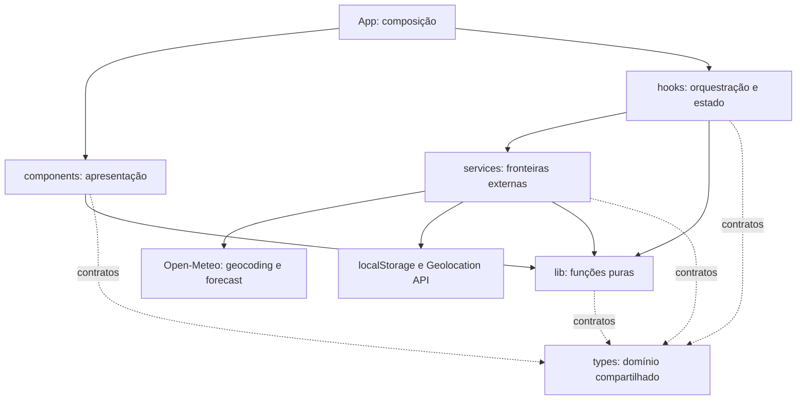
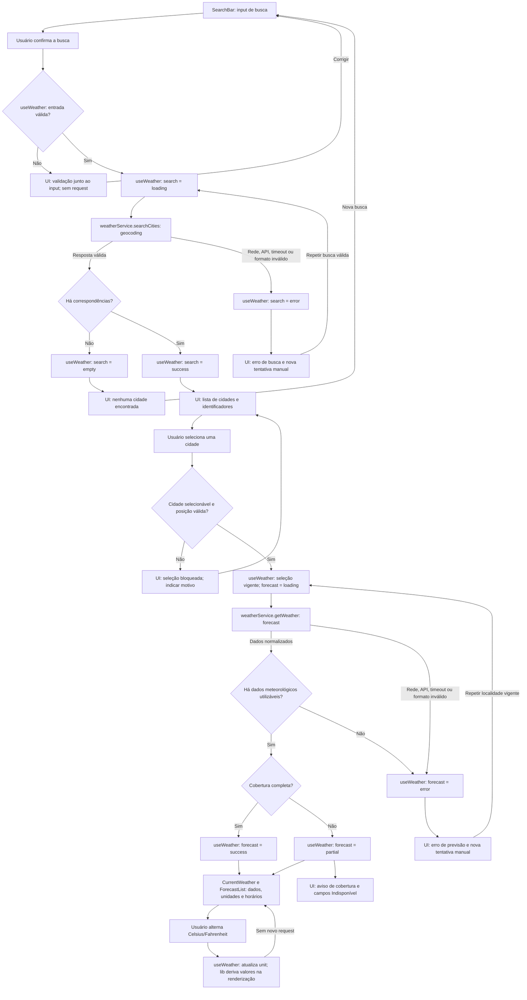

# Weather App — Plano Técnico

## Architecture

**Fonte da verdade:** [especificação de produto](../specs/weather-app-spec.md), aprovada em 11/11/2026. Este plano define decisões e contratos, não implementação. Os nomes de módulos novos são propostas para a fase Code; nenhum arquivo de aplicação é criado nesta etapa.

**Status:** plano documental fechado com as correções aprovadas pelo solicitante em 11/11/2026, apto à fase Tasks. Integração e produção continuam condicionadas às evidências dos [gates de verificação](#testing-strategy); fechamento do plano não declara API validada, testes executados ou disponibilidade comprovada.

### Organização das regras

Cada regra técnica tem uma seção mantenedora. As demais seções fornecem exemplos, fluxo ou justificativa e devem referenciá-la, não estabelecer políticas concorrentes. Em conflito com este plano, prevalece a especificação.

| Tema | Seção mantenedora |
|---|---|
| Camadas e dependências permitidas | [Architecture](#architecture) |
| Tipos, invariantes de domínio e persistência local | [Data Model](#data-model) |
| Endpoints, mapeamento externo, cache HTTP e viabilidade da API | [External APIs](#external-apis) |
| Estado, gerações, cancelamento, deadlines e conversão derivada | [State Management](#state-management) |
| Classificação de falhas, mensagens, recuperação e diagnóstico | [Error Handling](#error-handling) |
| Cobertura, protocolos de qualidade, evidências e gates | [Testing Strategy](#testing-strategy) |

Aplicação React de página única, distribuída como arquivos estáticos por HTTPS. O navegador acessa geocoding e previsão do Open-Meteo diretamente. Sem backend, autenticação, banco, analytics, serviço de identificação reversa ou cache meteorológico. Público estimado de 100 usuários não significa 100 usuários simultâneos nem determina consultas por dia.



As setas representam dependências, não o retorno de uma requisição. App chama o hook e entrega dados e callbacks aos componentes; eventos do usuário retornam pelos callbacks. Os componentes de apresentação não precisam conhecer a implementação do hook ou dos serviços.

| Responsabilidade | Decisão | Rastreabilidade |
|---|---|---|
| Apresentação | Componentes recebem dados de domínio; sem acesso direto a payloads externos. Textos em pt-BR, conteúdo não interpretado como HTML. | RF-01 a RF-11, AC-33, RNF-01 a RNF-03 |
| Coordenação | Um hook de feature mantém seleção, unidade e operações independentes de busca, previsão e localização. | RF-06, RD-05, RD-06, AC-30, AC-31, AC-40 |
| Integração | Service valida JSON recebido como desconhecido e entrega domínio normalizado ou erro categorizado. | RD-01 a RD-04, AC-34, AC-35 |
| Preferências | Somente unidade e última cidade manual em armazenamento local; previsão e posição do dispositivo nunca são persistidas. | RF-09, RF-10, AC-25 a AC-29, AC-39, AC-46 |
| Privacidade | Dados de localização apenas após ação e permissão; diagnóstico técnico com lista permitida de campos. | RF-08, RNF-09, RNF-10, AC-41, AC-49 |

### Limites e dependências permitidas

| Camada | Deve fazer | Pode depender de | Deve evitar |
|---|---|---|---|
| components | Renderizar dados, labels, loading, vazio e erros; emitir intenções por callbacks. Estado local apenas de interação, como texto em edição e dia expandido. | React, outros componentes, types e formatação pura de lib. | Fetch, localStorage, geolocalização, parsing de payload externo e cópias locais do forecast ou da unidade global. |
| hooks | Decidir quando buscar, qual operação está vigente e como publicar transições, seleção, unidade, retry e restauração. | React, services, types e lib. | JSX, detalhes de variáveis da Open-Meteo e acesso direto a storage ou APIs do dispositivo. |
| services | Encapsular HTTP, armazenamento e posição; decodificar dados externos e devolver domínio validado ou erro categorizado. | APIs da plataforma, types e validações puras de lib. | React, importação de components/hooks e decisões de exibição, foco ou seleção da operação vigente. |
| lib | Converter, formatar, validar valores e calcular datas, recortes e atualidade com entradas explícitas. | types e outras funções puras de lib, sem ciclos. | Rede, storage, DOM, hooks, logs e leitura implícita do relógio ou da posição. |
| types | Declarar domínio e contratos comuns sem execução. | Outros tipos do domínio, quando necessário. | Dependência de React, transporte ou estado de componentes. |

Payload bruto e detalhes específicos do provedor pertencem ao weatherService; validações de domínio reutilizáveis podem ser extraídas para lib. Uma função ser pura não obriga criar arquivo novo: separar apenas quando houver responsabilidade ou reutilização suficiente. Mensagem de erro visível deriva da categoria de erro, nunca do texto bruto retornado pela API.

A propriedade de timers, gerações e cancelamento está definida em [State Management](#state-management). Essa coordenação não pertence aos componentes ou aos adaptadores de plataforma.

### Por que facilita os testes

| Camada | Entrada controlada | Verificação isolada | Exemplo de aceite |
|---|---|---|---|
| components | Props e callbacks simulados. | Conteúdo, roles, teclado, mensagens e intenção emitida, sem montar a integração de rede. | AC-02, AC-03, AC-33, AC-47 |
| hooks | Services substituídos por promessas controladas e relógio simulado. | Transições, cancelamento, concorrência, timeout e manutenção de dados da identidade correta. | AC-19, AC-30, AC-31, AC-40, AC-45 |
| services | Fetch, localStorage e Geolocation API simulados na fronteira. | URLs e parâmetros, validação do payload, erros HTTP, leitura/gravação mínima e descarte de posição cancelada. | AC-27, AC-34, AC-39, AC-44, AC-46 |
| lib | Valores, timestamps, unidade e instante da consulta passados explicitamente. | Resultados determinísticos, limites, nulls, conversão e arredondamento sem navegador ou rede. | AC-06, AC-11, AC-12, AC-35, AC-36, AC-48 |

Essa separação permite mudar a resposta externa sem reescrever a UI, ajustar o layout sem alterar concorrência e testar regras de tempo sem esperar tempo real. Testes de integração e E2E continuam necessários para confirmar que as fronteiras estão conectadas corretamente; isolamento não substitui os gates de acessibilidade, desempenho e integração real.

**Publicação:** GitHub Pages é a primeira opção a verificar para hospedagem estática gratuita, sem domínio pago. Configurar o caminho-base do Vite para o nome do repositório, HTTPS e publicação do artefato de build. Não usar roteador: a experiência tem uma página, evitando necessidade de fallback de rotas. Elegibilidade, cotas, logs e condições da hospedagem precisam ser confirmados antes da publicação; alternativa gratuita equivalente só se respeitar as mesmas restrições. Não habilitar plano pago nem cobrança por excedentes.

**Monitoramento:** selecionar uma ferramenta externa gratuita compatível com o protocolo de disponibilidade de [Testing Strategy](#testing-strategy), sem cobrança automática ou adição de backend. Seleção e práticas de privacidade são evidências de execução pendentes, não SLA garantido.

## Tech Stack

Manter as tecnologias e versões declaradas em [package.json](../package.json), sem atualizar dependências nesta fase.

| Tecnologia | Uso e justificativa |
|---|---|
| TypeScript strict | Contratos explícitos, distinção entre dado ausente e valor zero e unions para estado e origem da localização. |
| React 19 + Vite | Reaproveitar a aplicação existente; SPA estática compatível com orçamento zero. |
| Tailwind CSS 3 | Preservar tema dark glassmorphism do projeto, com contraste e foco verificáveis; sem nova biblioteca de UI. |
| Fetch, AbortController, URL e URLSearchParams | Requisições canceláveis e parâmetros estruturados sem cliente HTTP adicional. |
| Intl.DateTimeFormat e Intl.NumberFormat | Brasília e apresentação pt-BR; validar suporte a arredondamento halfExpand nos navegadores da matriz. Converter antes de formatar. |
| Geolocation API | Posição opcional no navegador, apenas mediante ação explícita e contexto seguro. |
| localStorage | Duas preferências pequenas, independentes e locais, sem infraestrutura de dados. |
| Vitest + Testing Library + user-event | Funções de domínio, services, hook e interação acessível com dependências controladas. |
| Playwright | Fluxos completos com interceptação de rede, permissão, armazenamento e viewport controlados. |
| Biome + pnpm | Ferramentas já adotadas para lint, formatação, build e testes. |

Não adicionar Redux, biblioteca de cache de queries, IndexedDB, service worker ou biblioteca de datas inicialmente. Estado e volume de dados do MVP não justificam essas dependências. Validação de fronteira será pequena e explícita, testada; um validador de schemas só deve ser considerado se reduzir complexidade real durante Code.

## Project Structure

Reutilizar os arquivos existentes e ampliar suas responsabilidades sem criar uma segunda aplicação. A estrutura abaixo indica destino, não código já implementado.

```text
src/
	main.tsx                        entrada e montagem da aplicação
	App.tsx                         composição da página e ligação ao hook
	components/
		SearchBar.tsx                 entrada e seleção manual acessível
		CurrentWeather.tsx            cinco métricas atuais e avisos
		ForecastList.tsx              cinco datas de Brasília
		ForecastCard.tsx              resumo diário e acesso ao detalhe
		HourlyForecast.tsx            detalhe horário proposto
		UnitToggle.tsx                unidade escolhida
		LocationButton.tsx            ação explícita de localização proposta
		PreferencesControls.tsx       limpeza de preferências proposta
		states/
			LoadingState.tsx            carregamento acessível
			EmptyState.tsx              estado inicial ou sem resultados
			ErrorState.tsx              mensagem sanitizada e ação de recuperação
	hooks/
		useWeather.ts                 coordenação e operações da feature
	services/
		weatherService.ts             geocoding, forecast e validação externa
		preferencesService.ts         fronteira localStorage proposta
		geolocationService.ts         posição e descarte de callbacks cancelados
	types/
		weather.ts                    domínio e contratos compartilhados
	lib/
		temperature.ts                conversão sem arredondamento acumulado
		format.ts                     datas, números e rótulos pt-BR
		weatherCodes.ts               códigos conhecidos e descrições
		weatherValidation.ts          normalização pura proposta, se necessário
		weatherTime.ts                calendário de Brasília e recorte puro propostos
	styles/index.css                estilos globais e tokens existentes
tests/
	unit/                           ampliar suítes existentes; novas só onde necessário
	e2e/weather.spec.ts             reaproveitar cenários E2E existentes
```

Somente criar os módulos propostos quando a tarefa correspondente exigir. Os contratos atuais de [src/types/weather.ts](../src/types/weather.ts) não atendem integralmente à spec: faltam sensação térmica, horas, origem da seleção, dados nulos e horário da consulta. Pressão e precipitação atual presentes no contrato existente não são entregáveis desta versão; sua remoção ou desuso deverá ser coordenado com consumidores e testes na fase Code, sem ampliar o produto.

Os testes permanecem em tests/unit e tests/e2e, conforme o projeto; não criar uma árvore duplicada dentro de src. Manter um componente por arquivo e um único hook de feature enquanto a complexidade couber nele. Helpers de transição ou tempo são funções puras, não motivo para introduzir store global, camada de repositories, contêiner de injeção ou interfaces adicionais sem consumidor real.

## Data Model

### Convenções de domínio

- Temperaturas sempre em Celsius; vento em km/h e percentuais em [0, 100]. Unidade só afeta apresentação, nunca uma nova requisição.
- Métrica ausente ou inválida vira null, não zero. Condição desconhecida vira null. Preservar valores finitos válidos conforme RD-03; mínima maior que máxima invalida ambas.
- Instantes são milissegundos desde epoch UTC; datas de calendário são strings YYYY-MM-DD de Brasília. Não interpretar data local sem offset usando o fuso do dispositivo.
- Cinco posições diárias são materializadas para o calendário solicitado, mesmo quando faltam métricas. Horas inválidas são descartadas como períodos não associáveis, com indicação de cobertura parcial; lacunas não são preenchidas com valores inventados.
- Separar a série horária recebida da seleção de horas visíveis: a seleção usa receivedAt, em Brasília, e só é recalculada após nova consulta. Não há atualização contínua automática ou polling.

### Contratos de domínio propostos

As declarações abaixo são contratos de planejamento, sem corpos de funções ou implementação final. TypeScript não valida respostas JSON sozinho; os contratos só valem após validação de fronteira.

```typescript
type Unit = 'celsius' | 'fahrenheit'; // Unidade usada somente na apresentação.
type Instant = number; // Milissegundos desde epoch UTC.
type CalendarDate = string; // Data YYYY-MM-DD no calendário de Brasília.
type Measurement = number | null; // Valor validado ou ausência/invalidade.

interface Coordinates {
	latitude: number; // Latitude finita entre -90 e 90.
	longitude: number; // Longitude finita entre -180 e 180.
}

interface City extends Coordinates {
	id: number; // Identificador do geocoding.
	name: string; // Nome da cidade.
	country: string | null; // País, quando disponível.
	region: string | null; // Estado/região proveniente de admin1.
}

interface CityCandidate {
	city: City | null; // Cidade normalizada, se utilizável.
	label: string; // Identificação visível do resultado.
	selectable: boolean; // Permite seleção somente quando válida e distinguível.
	reason: 'invalid-position' | 'ambiguous' | null; // Motivo do bloqueio.
}

type SelectedLocation =
	| { kind: 'manual'; city: City } // Cidade escolhida na busca.
	| { kind: 'device'; coordinates: Coordinates; label: 'Localização atual' }; // Posição autorizada, sem persistência.

interface CurrentWeather {
	temperatureC: Measurement; // current.temperature_2m em Celsius.
	apparentTemperatureC: Measurement; // current.apparent_temperature em Celsius.
	weatherCode: number | null; // current.weather_code conhecido.
	humidityPercent: Measurement; // current.relative_humidity_2m em %.
	windSpeedKmh: Measurement; // current.wind_speed_10m em km/h.
	referenceAt: Instant | null; // current.time normalizado; validade do dado.
}

interface ForecastHour {
	at: Instant; // hourly.time normalizado para milissegundos UTC.
	temperatureC: Measurement; // hourly.temperature_2m em Celsius.
	weatherCode: number | null; // hourly.weather_code conhecido.
	precipitationProbabilityPercent: Measurement; // hourly.precipitation_probability em %.
}

interface ForecastDay {
	date: CalendarDate; // Data diária normalizada para Brasília.
	minC: Measurement; // daily.temperature_2m_min em Celsius.
	maxC: Measurement; // daily.temperature_2m_max em Celsius.
	weatherCode: number | null; // daily.weather_code conhecido.
	maxPrecipitationProbabilityPercent: Measurement; // daily.precipitation_probability_max em %.
	hours: ForecastHour[]; // Períodos horários associados a essa data.
	hourlyCoverage: 'complete' | 'partial' | 'unavailable'; // Cobertura derivada dos períodos.
}

interface WeatherData {
	location: SelectedLocation; // Cidade ou posição vinculada à consulta.
	timezone: 'America/Sao_Paulo'; // Fuso de exibição e agrupamento.
	receivedAt: Instant; // Recebimento da resposta, distinto da referência meteorológica.
	current: CurrentWeather | null; // Condições atuais utilizáveis, quando disponíveis.
	forecast: ForecastDay[]; // Exatamente cinco datas: hoje mais quatro.
	completeness: 'complete' | 'partial'; // Integridade do conjunto normalizado.
}

type Freshness = 'recent' | 'older-than-60-minutes' | 'unverifiable'; // Atualidade derivada da referência.

interface Preferences {
	unit: Unit; // Unidade válida restaurada ou Celsius como padrão.
	city: City | null; // Última cidade manual válida, sem posição do dispositivo.
}
```

`CityCandidate` representa inclusive um resultado inutilizável, que deve aparecer não selecionável com motivo compreensível; uma posição inválida nunca vira uma seleção. Um identificador, nome e posição válidos são necessários para persistir uma cidade manual. País e região podem estar ausentes; coordenadas distinguem homônimos quando necessário. Se nem isso permite diferenciar, bloquear a seleção, sem supor uma cidade correta.

`WeatherData.forecast` deve conter exatamente cinco datas ordenadas, geradas no calendário de Brasília. Um período inválido não pode deslocar a associação dos valores dos demais períodos: validar índice e timestamp na resposta antes de normalizar. Completeness é partial quando falta qualquer campo exigido ou cobertura; ausência de qualquer dado meteorológico utilizável e associável gera erro de dados inválidos em vez de um sucesso vazio. Metadados e datas sem métricas, sozinhos, não constituem conteúdo meteorológico utilizável.

### Contratos das fronteiras

```typescript
type ErrorCode =
	| 'invalid-input'
	| 'network'
	| 'timeout'
	| 'rate-limit'
	| 'provider'
	| 'invalid-data'
	| 'permission-denied'
	| 'position-unavailable'
	| 'unsupported'
	| 'storage-unavailable';

interface AppError {
	code: ErrorCode;
	retryable: boolean;
	httpStatus?: number;
}

interface WeatherService {
	searchCities(query: string, signal: AbortSignal): Promise<CityCandidate[]>;
	getWeather(location: SelectedLocation, signal: AbortSignal): Promise<WeatherData>;
}

interface PreferencesService {
	read(): Preferences;
	writeUnit(unit: Unit): boolean;
	writeCity(city: City): boolean;
	clear(): boolean;
}

interface GeolocationService {
	requestPosition(signal: AbortSignal): Promise<Coordinates>;
}

interface DiagnosticEvent {
	category: ErrorCode;
	operation: 'search' | 'forecast' | 'location' | 'preferences';
	httpStatus?: number;
	durationMs: number;
	at: Instant;
}
```

Operações assíncronas podem rejeitar com AppError; descarte e publicação seguem [State Management](#state-management). Services respeitam signal durante transporte e leitura e retornam erros segundo [Error Handling](#error-handling), sem payload bruto nos contratos públicos. Não criar framework genérico de repositories: esses três contratos bastam.

Preferências usam chaves separadas e versionadas pelo nome, por exemplo weather-app:v1:unit e weather-app:v1:city. Salvar somente os campos de RF-09; sem data, histórico, forecast ou dados de dispositivo. JSON deve ser lido como unknown e validado; cidade e unidade são independentes, inclusive quando a gravação falha. `clear()` tenta remover ambas, confirma o resultado e só informa sucesso se nenhuma preferência permanecer; se uma remoção falhar, comunicar falha sem apagar dados não pertencentes ao app. Limpeza não deve ser desfeita por callback de requisição antiga.

## Data Flow



O diagrama representa chamadas e resultados, não importações. A semântica dos estados e a vigência das operações estão em [State Management](#state-management); falhas, respostas parciais e nova tentativa seguem [Error Handling](#error-handling).

1. **Abertura:** ler preferências uma vez por inicialização efetiva; restaurar unidade válida ou Celsius, validar a cidade separadamente. Cidade válida dispara forecast novo; sem cidade, mostrar estado inicial. Nenhuma solicitação de geolocalização é automática.
2. **Busca explícita:** normalizar apenas espaços nas extremidades, validar de 1 a 100 caracteres Unicode, construir a URL de forma estruturada e iniciar a geração vigente de busca. Não usar autocomplete por requisição a cada tecla. A lista não muda a cidade meteorológica selecionada.
3. **Seleção manual:** validar seletividade e coordenadas, cancelar forecast e localização superados, definir identidade da cidade, ocultar resultados de outra localidade e salvar somente a cidade manual. Consultar forecast sem esperar sucesso do salvamento.
4. **Localização:** após ação explícita e explicação de privacidade, obter posição e gerar seleção device, respeitando o ciclo de operação de [State Management](#state-management) e as restrições de persistência de [Data Model](#data-model).
5. **Resposta:** verificar identidade e deadline antes de publicar qualquer efeito; validar dados e unidades, normalizar instantes e cinco datas e calcular recorte horário e idade com receivedAt. Payload parcial preserva partes válidas. A série não pode ser atribuída ao texto que está sendo editado.
6. **Apresentação:** componentes recebem domínio e callbacks; a conversão derivada de [State Management](#state-management) usa a unidade atual e funções puras.
7. **Falha e nova tentativa:** aplicar a política de recuperação de [Error Handling](#error-handling), preservando a identidade dos dados.
8. **Limpeza:** remover as duas preferências e informar sucesso ou falha. Em nova abertura sem outra seleção, não restaurar cidade e usar Celsius. Não exigir que a previsão já visível seja apagada: limpar persistência não significa apagar dados da sessão.

O isolamento de relógio e fronteiras e a verificação de inicialização do React pertencem a [Testing Strategy](#testing-strategy).

## External APIs

### Endpoints e parâmetros candidatos

Os contratos externos abaixo são candidatos para validação, não confirmação de resposta atual. Não foram executadas consultas de rede para produzir este plano. A spec permanece fonte da verdade em caso de incompatibilidade.

| Operação | Endpoint | Parâmetros planejados |
|---|---|---|
| Busca de cidades | https://geocoding-api.open-meteo.com/v1/search | name com termo validado, language=pt, format=json, count=10 como página inicial simples; sem filtros de país. |
| Previsão | https://api.open-meteo.com/v1/forecast | latitude, longitude, timezone=America/Sao_Paulo, forecast_days=5, temperature_unit=celsius, wind_speed_unit=kmh e grupos current, daily e hourly abaixo. |

A lista de até dez resultados é um limite de apresentação do MVP, não afirmação de que todas as cidades homônimas foram retornadas. Sem paginação ou filtros adicionais neste plano; registrar insuficiência de cobertura como risco, não inventar resultado.

Os parâmetros completos, as unidades e a interpretação dos timestamps estão documentados nos contratos de geocoding e forecast abaixo. Suas regras de normalização complementam os invariantes de [Data Model](#data-model).

### Geocoding — contrato da busca

**Método e URL:** GET https://geocoding-api.open-meteo.com/v1/search

| Parâmetro | Valor / regra |
|---|---|
| name | Nome após remoção de espaços nas extremidades, com 1 a 100 caracteres. Codificar por URLSearchParams, sem remover acentos. |
| count | 10 resultados no máximo na consulta planejada. |
| language | pt para nomes traduzidos quando oferecidos; não garante tradução de todos os topônimos. |
| format | json. |

Exemplo de URL: https://geocoding-api.open-meteo.com/v1/search?name=S%C3%A3o%20Paulo&count=10&language=pt&format=json

**Resposta resumida ilustrativa:** dados sintéticos, não captura de uma consulta executada; campos não utilizados foram omitidos.

```json
{
	"results": [
		{
			"id": 3448439,
			"name": "São Paulo",
			"latitude": -23.5475,
			"longitude": -46.6361,
			"country": "Brasil",
			"admin1": "São Paulo",
			"timezone": "America/Sao_Paulo"
		}
	]
}
```

| Origem JSON | Destino / validação |
|---|---|
| results[].id | City.id; exigir identificador numérico válido para uma cidade persistível. |
| results[].name | City.name; exigir texto não vazio e renderizar como texto. |
| results[].country | City.country; ausência vira null. |
| results[].admin1 | City.region; ausência vira null. |
| results[].latitude, longitude | City.latitude e longitude; validar finitude e limites de RD-01. |
| results[].timezone | Não determina o fuso de apresentação: o produto usa Brasília para qualquer cidade. Não persistir esse campo. |
| Resultado normalizado | CityCandidate.city e label; definir selectable e reason conforme posição e possibilidade de distinguir resultados. |

results vazio ou ausente em uma resposta de sucesso válida representa busca sem correspondência; results com tipo inesperado ou corpo inválido representa invalid-data, não lista vazia. Um item inválido não deve impedir o uso de outros itens válidos. A busca não inicia previsão sem seleção; resultado único também não dispensa a seleção explícita nesta experiência.

### Forecast — contrato da previsão

**Método e URL:** GET https://api.open-meteo.com/v1/forecast

| Parâmetro | Valor / regra |
|---|---|
| latitude, longitude | Coordenadas validadas da City selecionada ou da posição autorizada; nunca texto livre do input. |
| current | temperature_2m,apparent_temperature,weather_code,relative_humidity_2m,wind_speed_10m |
| daily | weather_code,temperature_2m_min,temperature_2m_max,precipitation_probability_max |
| hourly | temperature_2m,weather_code,precipitation_probability |
| timezone | America/Sao_Paulo, independentemente do fuso da cidade e do dispositivo. |
| forecast_days | 5: hoje mais quatro datas no calendário solicitado. |
| temperature_unit | celsius; Fahrenheit é conversão de apresentação, sem nova consulta. |
| wind_speed_unit | kmh. |
| timeformat | unixtime: timestamps externos em segundos; confirmar semântica diária e offset no gate externo. |

Exemplo de URL completa, com posição ilustrativa de São Paulo:

```text
https://api.open-meteo.com/v1/forecast?latitude=-23.5475&longitude=-46.6361&current=temperature_2m,apparent_temperature,weather_code,relative_humidity_2m,wind_speed_10m&daily=weather_code,temperature_2m_min,temperature_2m_max,precipitation_probability_max&hourly=temperature_2m,weather_code,precipitation_probability&timezone=America%2FSao_Paulo&forecast_days=5&temperature_unit=celsius&wind_speed_unit=kmh&timeformat=unixtime
```

**Resposta resumida ilustrativa:** valores sintéticos de 01 e 02/01/2024; somente dois dias e duas horas são mostrados para abreviar. Uma resposta completa deve ser verificada para as cinco datas e sua cobertura horária. Este recorte não é uma fixture de sucesso completo nem evidência de suporte atual do provedor.

```json
{
	"latitude": -23.55,
	"longitude": -46.63,
	"timezone": "America/Sao_Paulo",
	"utc_offset_seconds": -10800,
	"current_units": {
		"time": "unixtime",
		"temperature_2m": "°C",
		"apparent_temperature": "°C",
		"weather_code": "wmo code",
		"relative_humidity_2m": "%",
		"wind_speed_10m": "km/h"
	},
	"current": {
		"time": 1704110400,
		"temperature_2m": 25.2,
		"apparent_temperature": 26.4,
		"weather_code": 2,
		"relative_humidity_2m": 70,
		"wind_speed_10m": 12.5
	},
	"daily_units": {
		"time": "unixtime",
		"weather_code": "wmo code",
		"temperature_2m_min": "°C",
		"temperature_2m_max": "°C",
		"precipitation_probability_max": "%"
	},
	"daily": {
		"time": [1704078000, 1704164400],
		"weather_code": [2, 3],
		"temperature_2m_min": [19.5, 20.0],
		"temperature_2m_max": [28.0, 27.5],
		"precipitation_probability_max": [40, null]
	},
	"hourly_units": {
		"time": "unixtime",
		"temperature_2m": "°C",
		"weather_code": "wmo code",
		"precipitation_probability": "%"
	},
	"hourly": {
		"time": [1704110400, 1704114000],
		"temperature_2m": [25.2, 26.0],
		"weather_code": [2, 3],
		"precipitation_probability": [20, 40]
	}
}
```

| Origem JSON | Destino / transformação |
|---|---|
| current.temperature_2m | CurrentWeather.temperatureC, finito ou null. |
| current.apparent_temperature | CurrentWeather.apparentTemperatureC, finito ou null. |
| current.weather_code | CurrentWeather.weatherCode; código conhecido ou null, com rótulo em weatherCodes. |
| current.relative_humidity_2m | CurrentWeather.humidityPercent, validado em [0, 100]. |
| current.wind_speed_10m | CurrentWeather.windSpeedKmh, finito e não negativo. |
| current.time | CurrentWeather.referenceAt; segundos para milissegundos UTC, sem somar offset ao instante. No exemplo, 1704110400000 representa 01/01/2024 às 09:00 em Brasília. Não é o horário da última consulta. |
| daily.time[indice] | ForecastDay.date; obter a data do dia agregado segundo a semântica documentada de timeformat e utc_offset_seconds. No exemplo sintético, o primeiro timestamp representa meia-noite de Brasília de 01/01/2024. Confirmar esse comportamento na resposta real antes de fixar fixtures. |
| daily.temperature_2m_min[indice], temperature_2m_max[indice] | ForecastDay.minC e maxC; preservar o pareamento por dia e invalidar ambos se mínima exceder máxima. |
| daily.weather_code[indice] | ForecastDay.weatherCode; não substituir por uma condição horária arbitrária. |
| daily.precipitation_probability_max[indice] | ForecastDay.maxPrecipitationProbabilityPercent; null continua null, nunca zero ou probabilidade de outra janela. |
| hourly.time[indice] | ForecastHour.at; multiplicar segundos por 1000 e agrupar pela data em Brasília. |
| hourly.temperature_2m[indice] | ForecastHour.temperatureC. |
| hourly.weather_code[indice] | ForecastHour.weatherCode conhecido ou null. |
| hourly.precipitation_probability[indice] | ForecastHour.precipitationProbabilityPercent, validado em [0, 100]. |
| Horas normalizadas por data | ForecastDay.hours e hourlyCoverage; não confundir filtragem das horas passadas com lacuna do provedor. |
| current + daily + hourly normalizados | WeatherData.current, forecast e completeness. Criar cinco datas esperadas e marcar ausências como cobertura parcial; nenhum dado meteorológico utilizável gera invalid-data. |

WeatherData.location vem da seleção vigente, não das coordenadas arredondadas de grade retornadas pelo forecast; elas podem diferir da posição solicitada. WeatherData.timezone é o fuso contratado e deve ser conferido contra o payload. WeatherData.receivedAt vem do relógio da aplicação no recebimento da resposta vigente utilizável; generationtime_ms, quando presente, é duração de processamento do provedor, não referência meteorológica ou última consulta.

No recorte ilustrativo, somente a primeira data tem máxima diária de probabilidade disponível; a segunda preserva null. As duas horas representam 09:00 e 10:00 de Brasília no primeiro dia. Se receivedAt estiver às 09:30 desse dia, somente 10:00 fica visível em hoje. Não usar os timestamps fixos do exemplo como previsão atual.

**Erros externos:** aplicar a ordem de classificação e a sanitização definidas em [Error Handling](#error-handling), antes de publicar o domínio normalizado.

### Transporte e limites

- GET por Fetch com signal, parâmetros construídos por URLSearchParams, sem API key e sem credenciais de sessão. A API recebe localidade ou coordenadas necessárias: proibição de logs não elimina o envio necessário ao provedor.
- Uma busca explícita faz uma chamada de geocoding; uma seleção, restauração ou nova tentativa de previsão faz uma chamada forecast incluindo os três grupos. Conversão C/F, abertura de detalhe e limpeza não chamam API.
- Para forecast, usar explicitamente cache: 'no-store' no Fetch: não ler nem gravar sua resposta no cache HTTP do navegador. Não usar 'no-cache', que admite reutilização após revalidação. Verificar esse comportamento no navegador; a aplicação não controla caches internos do provedor. Permanecem excluídos cache de aplicação, service worker e polling.
- Deadlines e cancelamento seguem [State Management](#state-management); retentativas e resposta tardia seguem [Error Handling](#error-handling).
- A origem, CORS e conteúdo permitido devem ser verificados no navegador da hospedagem, sem contornar bloqueios com proxy pago ou adicionar servidor silenciosamente.

### Gate de viabilidade externa

**Primeira tarefa da fase Tasks: VAL-API — validar a integração externa.** Consultar documentação vigente e executar o procedimento leve abaixo antes de fechar o adapter. Saída exigida: matriz de capacidades com evidências datadas, fixtures reais sanitizadas quando permitidas, mapeamento de unidades e timestamps e situação de cada OQ. Mocks e contratos provisórios permitem avançar em testes isolados, mas não aprovam a integração.

| Pendência da spec | Evidência necessária antes da integração ser aceita |
|---|---|
| OQ-04 | Dados recebidos pelo provedor, atribuição e avisos de privacidade; logs, retenção e acesso da hospedagem. |
| OQ-05 | Significado de current.time ou referência equivalente: validade do dado, não atualização do modelo. Caso não esteja disponível, preservar comportamento de atualidade não verificável, sem inventar timestamp. |
| OQ-06 | Cinco datas e horas de Brasília, unidades e agregações exigidas, inclusive para cidade de outro fuso e dados parciais. |
| OQ-08 | Elegibilidade não comercial, limites gratuitos e atribuição vigentes; confirmar ausência de custos obrigatórios e estimar frequência e concorrência para 100 usuários. |

Consultar [Forecast API](https://open-meteo.com/en/docs), [Geocoding API](https://open-meteo.com/en/docs/geocoding-api), [termos](https://open-meteo.com/en/terms) e [condições de acesso](https://open-meteo.com/en/pricing). A presença de links e variáveis neste plano não comprova verificação atual.

Primeira verificação leve: até quatro consultas sequenciais, duas de geocoding (nome acentuado e sem correspondência) e duas de forecast (cidade brasileira e outra em fuso distinto), cada uma com limite de 10 segundos e sem retry, no máximo 40 segundos de espera de rede. Registrar data, status, duração, tamanho, campos, unidades e quantidade de períodos sem dados pessoais reais. CORS exige teste próprio no navegador. Não executar os 200 cenários de medição real nem teste de carga nessa validação inicial.

**Aceite de VAL-API:** comprovar os campos e agregações exigidos e a interpretação de tempo; validar CORS na origem prevista; documentar elegibilidade, cotas e atribuição para uso não comercial e orçamento zero. Registrar frequência de consultas e pico esperado, ainda não informados. Verificação de logs da hospedagem pode ocorrer na escolha do host, mas é obrigatória antes do deploy. Sem reverse geocoding: “Localização atual” já resolve a identificação da origem device.

Se uma capacidade essencial não existir, marcar a integração como bloqueada e pedir decisão de escopo antes de substituir dados ou serviço. Evidência ausente não é aceite; adaptação aprovada posteriormente deve atualizar o contrato e seus testes.

## State Management

Estado de feature em useWeather com useReducer para transições relacionadas; campo em edição e painel horário aberto ficam nos componentes apropriados. Não usar estado global externo ou duplicar forecast em componentes filhos.

### Onde o estado vive

| Estado / recurso | Responsável | Regra |
|---|---|---|
| Unidade, localidade selecionada e estados de busca/previsão/localização | useWeather, instanciado por App | Fonte única de verdade da feature; filhos recebem dados e callbacks. |
| Texto digitado, foco de interação e dia expandido | Componentes de apresentação | Editar o termo não seleciona outra cidade; abrir um dia não dispara rede. |
| Controllers, timers e gerações vigentes | Referências de useWeather | Não são persistidos nem usados como cópias dos dados renderizáveis; limpar na substituição e desmontagem. |
| Última unidade e cidade manual | preferencesService sobre localStorage | Apenas persistência; não é uma segunda store reativa nem contém forecast. Restaurar valores válidos independentemente. |
| Temperaturas formatadas, recorte horário e atualidade | Derivação pura com lib | Calcular a partir dos dados canônicos, da unidade atual e do instante registrado; não manter cópias sincronizadas por efeitos. |

### Estados explícitos e significado

Busca e previsão não compartilham um único status global: uma busca pode estar loading enquanto a previsão da cidade já selecionada continua visível. O estado local de validação do input não deve ser confundido com falha do provedor.

| Status | Busca | Previsão | Efeito visível |
|---|---|---|---|
| idle | Nenhuma busca submetida. | Nenhuma localidade consultada. | Estado inicial, sem mensagem de falha. |
| loading | Busca vigente aguardando resultado. | Consulta vigente aguardando resultado. | Anunciar carregamento; na previsão, dados anteriores só podem permanecer para a mesma identidade. |
| success | Lista não vazia recebida, inclusive itens não selecionáveis identificados. | Conjunto utilizável com cobertura e métricas completas. | Exibir resultados correspondentes à operação vigente. |
| empty | Busca válida concluída sem correspondências. | Não utilizado para resposta meteorológica sem conteúdo útil. | Informar “Nenhuma cidade encontrada” e permitir corrigir a busca; não iniciar forecast. |
| partial | Não é status separado da lista; itens inválidos são tratados por CityCandidate. | Há dados meteorológicos válidos e associáveis, mas falta campo, período ou cobertura exigida. | Exibir dados válidos, “Indisponível” nos campos afetados e aviso de cobertura. |
| error | Falha de rede, API, timeout ou formato inválido da busca. | Falha total, timeout ou nenhuma métrica utilizável e associável. | Mensagem sanitizada e recuperação apropriada, sem declarar sucesso vazio. |

Localização usa idle, loading, success e error; não tem empty. success significa que a posição foi obtida com autorização, não que o forecast já terminou. O forecast continua com seu próprio loading ou resultado. Falha de preferências gera aviso não bloqueante, não substitui success meteorológico por error de armazenamento.

```typescript
type SearchState =
	| { status: 'idle' }
	| { status: 'loading'; requestId: number; query: string }
	| { status: 'empty'; query: string }
	| { status: 'success'; query: string; results: CityCandidate[] }
	| { status: 'error'; query: string; error: AppError };

type ForecastState =
	| { status: 'idle' }
	| { status: 'loading'; location: SelectedLocation; previous: WeatherData | null }
	| { status: 'success' | 'partial'; data: WeatherData }
	| { status: 'error'; location: SelectedLocation; error: AppError; previous: WeatherData | null };

interface WeatherState {
	unit: Unit;
	selectedLocation: SelectedLocation | null;
	search: SearchState;
	forecast: ForecastState;
	locationStatus: 'idle' | 'loading' | 'success' | 'error';
	locationError: AppError | null;
	preferencesWarning: boolean;
}
```

### Ciclo de vida das operações

- useWeather é o único proprietário de intenção, gerações e deadlines. AbortControllers, timers e contadores ficam em referências do hook, não são dados renderizáveis. Services respeitam signal sem criar timers ou retry próprios.
- Busca, forecast e obtenção de posição têm deadlines independentes de 10 segundos. O prazo de dados abrange transporte, leitura e validação antes de publicação. O prazo de posição começa na solicitação explícita, inclusive durante espera por permissão; obter posição com sucesso inicia uma consulta de forecast com prazo novo.
- Cada canal tem geração monotônica; toda conclusão deve conferir geração e prazo antes de produzir efeitos. Timeout, substituição ou desmontagem invalidam a geração e abortam quando possível. Se a plataforma não cancelar fisicamente a operação, seus callbacks e respostas continuam sendo descartados.
- Nova seleção manual invalida localização pendente e forecast anterior; nova busca invalida somente a busca anterior, sem trocar a cidade meteorológica. Uma posição obtida só substitui a seleção se sua intenção continuar vigente.
- Limpar timers na conclusão, cancelamento e desmontagem. A política de mensagens e recuperação de erros está em [Error Handling](#error-handling).

| Evento | Transição e invariantes |
|---|---|
| Inicialização | Unidade válida ou Celsius; cidade válida dispara forecast loading sem geolocalização; sem cidade, forecast idle. |
| Nova busca válida | search loading; invalidar busca anterior; não alterar forecast selecionado. |
| Resultado sem cidades | search empty; não iniciar forecast nem associar previsão ao termo. |
| Resultado com cidades | search success; aguardar seleção explícita de item válido. |
| Seleção de outra identidade | forecast loading sem previous; ocultar dados antigos imediatamente. |
| Atualização da mesma identidade | forecast loading com previous opcional; não alterar sua referência nem receivedAt. |
| Forecast válido | success ou partial conforme cobertura, somente na geração vigente. |
| Falha vigente | error com previous somente da mesma identidade, aviso e retry manual. |
| Nova tentativa explícita | A operação com erro volta a loading com nova geração e deadline; nenhuma retentativa automática. |
| Posição autorizada obtida | locationStatus success; iniciar forecast para “Localização atual” com deadline próprio e sem persistir a posição. |
| Troca de unidade | Alterar somente unidade e sua preferência; nenhuma resposta de forecast pode revertê-la. |
| Limpeza de preferências | Remover registros, sem disparar consulta ou efeito que os recrie; escrita futura só após nova escolha explícita. |

Identidade manual é vinculada à cidade validada; identidade device à posição autorizada da consulta. Não aproximar duas posições diferentes como se fossem a mesma cidade apenas por distância. Freshness e apresentação são derivados de dados e relógio registrado na consulta, não estados duplicados que podem divergir.

### Celsius/Fahrenheit como valor derivado

1. Manter temperatura atual, sensação, mínimas, máximas e temperaturas horárias somente em Celsius no WeatherData. A resposta externa sempre solicita Celsius.
2. Na renderização, passar o valor canônico e a Unit vigente às funções puras de temperature e format: Celsius mantém o valor; Fahrenheit aplica a relação Celsius × 9/5 + 32.
3. Converter antes de arredondar. Aplicar uma casa decimal, vírgula decimal, empates afastados de zero e normalização do zero negativo; null continua “Indisponível”, sem conversão numérica.
4. Ao alternar, atualizar apenas unit e sua preferência, quando storage estiver disponível. Não alterar WeatherData, requestId, referência meteorológica ou receivedAt; não disparar Fetch, resetar loading ou reiniciar deadline.
5. Se o usuário alternar durante uma consulta, o resultado recebido é renderizado na unidade que estiver vigente naquele momento. Respostas não carregam nem restauram uma unidade capturada no início da operação.

Exemplos verificáveis: 10 °C aparece como “10,0 °C” ou “50,0 °F”; -10 °C como “-10,0 °C” ou “14,0 °F”. Alternâncias repetidas partem sempre do mesmo Celsius original, não do texto arredondado. Vento, umidade, probabilidades, cidade e datas não mudam (AC-07, AC-14, AC-15, AC-36, AC-40 e AC-47). Não adicionar estado de temperaturas convertidas nem useEffect para sincronizá-lo; memoização não é necessária por padrão para o volume do MVP.

## Error Handling

### Classificação e ordem de tratamento

1. Aplicar a verificação de vigência de [State Management](#state-management). Substituição ou desmontagem não gera erro visível, inclusive quando a conclusão descartada é uma falha.
2. Se o deadline vigente encerrou a operação, classificar timeout. AbortError isolado não comprova timeout: a causa vem do ciclo da operação, não do nome do erro de plataforma.
3. Falha de Fetch sem resposta HTTP é network. O navegador pode não distinguir desconexão, DNS e bloqueio CORS; mostrar mensagem de conexão, sem afirmar uma causa específica não comprovada.
4. Com resposta HTTP, conferir status antes de decodificar domínio: 429 é rate-limit; 5xx ou outros status não exitosos são provider. Sem retry automático; status e duração podem integrar o diagnóstico permitido, não o corpo bruto.
5. HTTP de sucesso não garante payload válido: JSON ilegível ou estrutura essencial inválida gera invalid-data; indicação explícita de erro do provedor gera provider. Só depois normalizar campos e períodos.
6. Campos isolados inválidos não transformam toda a consulta em error se houver conteúdo meteorológico utilizável e associável: publicar partial, preservar partes válidas e indicar ausências. Se nenhum conteúdo útil sobreviver, publicar error invalid-data. Uma referência temporal ausente, por si só, indica atualidade não verificável e não invalida métricas associáveis.

Input inválido é validado antes do transporte e não chama API. Geocoding sem correspondências é empty, nunca network ou provider; uma lista de itens inválidos exige indicação de indisponibilidade de seleção, não escolha automática. A classificação de AppError é separada da mensagem em pt-BR e dos DiagnosticEvents para não vazar dados do payload.

| Situação | Tratamento | Critérios principais |
|---|---|---|
| Nome vazio ou fora do limite | Mensagem associada ao input, nenhuma chamada e possibilidade de corrigir. | AC-02, AC-42 |
| Cidade inexistente | Estado vazio, sem erro de conexão; dados anteriores continuam identificados se permanecerem visíveis. | AC-17, AC-37 |
| Resultado ambíguo ou coordenadas inválidas | Não selecionável; motivo textual e alternativa de nova busca. | AC-03, AC-04, AC-34, AC-43 |
| Desconexão, HTTP 5xx ou limite HTTP 429 | Erro sanitizado de rede, provedor ou rate-limit; nenhuma repetição automática; nova tentativa manual. | AC-18, AC-33 |
| Timeout | Encerrar no limite de 10 segundos, invalidar geração, abortar quando possível e descartar conclusão tardia. | AC-19, AC-31, AC-44 |
| Cancelamento por troca ou desmontagem | Limpar timer e ignorar resultado; não mostrar erro de rede por uma ação intencional de substituição. | AC-30, AC-40 |
| Resposta parcial | Normalizar métricas inválidas para null e preservar partes válidas, com aviso de cobertura. | AC-06, AC-13, AC-35 |
| JSON inválido ou nenhum dado utilizável | Erro invalid-data; não publicar forecast rotulado como sucesso. | RD-02, AC-35 |
| Referência antiga, futura ou ausente | Acima de 60 minutos, aviso; futura/ausente, atualidade não verificável. Preservar referência e consulta distintas. | AC-20, AC-21, AC-48 |
| Localização recusada ou indisponível | Mensagem específica e busca manual; sem salvar ou repetir posição automaticamente. | AC-22 a AC-24, AC-38, AC-44, AC-49 |
| Storage indisponível ou registro corrompido | Manter uso em memória, recuperar cada preferência válida separadamente; não declarar limpeza bem-sucedida se falhar. | AC-25 a AC-29, AC-46 |

### Recuperação e apresentação

- Nova tentativa manual repete a busca ou a previsão da identidade associada ao erro vigente, com nova geração e prazo. Em rate-limit, não criar loop de retry nem ignorar restrições de uso do provedor.
- Ao mudar de localidade, ocultar imediatamente o forecast anterior. Na mesma identidade, um erro pode manter o último resultado em memória somente com aviso de falha; sua referência e receivedAt não mudam. Não persistir esses dados nem apresentá-los como cache atualizado.
- Em partial, manter navegação pelos cinco dias e campos válidos; dia ou campo sem cobertura indica “Indisponível”, zero válido continua zero e não se adiciona sexto dia para substituir ausência.
- Sucesso vigente retira o erro anterior do respectivo canal; falha de storage ou de localização não apaga uma consulta manual bem-sucedida. Não usar uma única mensagem global que esconda qual ação falhou.
- Verificações de fronteira, timeout e conversão estão na cobertura de [Testing Strategy](#testing-strategy); não confundir testes com relógio controlado com medição real de latência.

Mensagens visíveis são mapeadas por categoria em pt-BR; nunca usar diretamente erro bruto, URL da consulta ou payload. Texto dinâmico é renderizado como texto React, sem HTML injetado. Estados têm rótulos semânticos, aria-busy e anúncio apropriado de erro/resultado, sem roubar foco a cada resposta. Suporte a teclado inclui seleção, unidade, localização, detalhe horário, nova tentativa e limpeza.

### Política de diagnóstico

Registrar um DiagnosticEvent no console por falha terminal da operação vigente: rede, API, rate-limit, timeout, invalid-data, obtenção de posição ou leitura/gravação/limpeza de preferências. Se várias chaves falharem na mesma operação de preferências, emitir um evento agregado sem valores das chaves. Não registrar validação de input, busca vazia, sucesso, cancelamento intencional ou conclusão de geração obsoleta. Uma nova tentativa que falhar é uma nova operação, com seu próprio evento.

Usar somente category, operation, httpStatus quando houver, durationMs e at, conforme [Data Model](#data-model). São proibidos objeto Error completo, URL/query, cidade, coordenadas, identificador pessoal, payload ou stack. O erro sanitizado é construído antes do log; nunca serializar o objeto bruto para depois filtrá-lo. Falha do console não pode interromper a aplicação. Não enviar ou persistir esses eventos; logs externos da hospedagem são verificação separada. AC-41 deve comprovar tanto o evento exigido quanto os campos excluídos.

## Testing Strategy

### Vitest — funções, services, hooks e componentes

Reutilizar a [matriz de rastreabilidade da spec](../specs/weather-app-spec.md#L81). Nomear cenários com AC para que tarefas e evidências apontem aos mesmos IDs; cada variação é um caso separado. Testes automatizados usam relógio, rede, posição e armazenamento controlados; não chamam o Open-Meteo por padrão.

| Camada / suíte | Cobertura | Rastreabilidade |
|---|---|---|
| Funções de temperatura e formato | 0, positivos, negativos e frações; round-trip sem acúmulo; empates afastados de zero; zero negativo; datas/horas em Brasília. | AC-07, AC-12, AC-14, AC-15, AC-36, AC-47 |
| Normalização e weatherService | Coordenadas, códigos desconhecidos, unidades inesperadas, arrays incompletos, valores ausentes/zero/inválidos, datas, cinco slots diários e cobertura horária. | AC-01, AC-03 a AC-13, AC-34, AC-35, AC-43, AC-48 |
| useWeather e operações concorrentes | Busca e seleção A/B, erro atrasado, timeout em 9.999/10.000 ms, mesmo local versus outro, unidade alterada em voo e efeitos desmontados. | AC-16 a AC-19, AC-30, AC-31, AC-37, AC-40, AC-45 |
| Geolocalização | Sem pedido automático, permissão, recusa, falta de suporte, prazo global e callback tardio descartado; alternativa manual. | AC-22 a AC-24, AC-27, AC-38, AC-44, AC-49 |
| Preferências | Escrita somente manual, unidade/cidade independentes, reabertura e consulta nova, armazenamento bloqueado, remoção parcial com falha e ausência de histórico. | AC-25 a AC-29, AC-39, AC-46 |
| Componentes e interação | Nomes legítimos, limites de input, escape de conteúdo, labels e mensagens, seleção e estados; cinco dias e detalhe acessível. | AC-01 a AC-24, AC-32, AC-33, AC-42, AC-47 |
| Privacidade | Verificar console, requisições e storage com dados sintéticos; ausência de logs centralizados e envio de posição sem permissão. | AC-27, AC-39, AC-41, AC-49, RNF-09, RNF-10 |

Ampliar primeiro as suítes existentes de App, SearchBar, UnitToggle, weatherService, temperature, format e weatherCodes. Criar uma suíte de hook ou de fronteira nova apenas quando não houver arquivo adequado; compartilhar fixtures de payloads entre cenários. Mock de Fetch controlado basta para unitários; interceptação route do Playwright basta para E2E, sem introduzir servidor de mocks por padrão.

**Funções puras:** testar os contratos de conversão de [State Management](#state-management) e de normalização de [Data Model](#data-model), com positivos, negativos, frações, null, zero, empates e ida/volta. Datas e recortes recebem instantes explícitos, incluindo exatamente a hora atual e viradas de calendário; não ler relógio real ou depender do fuso do processo.

**Services com mock de Fetch:** conferir método, origem, parâmetros por URLSearchParams, signal e ausência de credenciais, sem depender da ordem textual da query. Usar respostas controladas para sucesso, geocoding vazio, HTTP 429/5xx, erro de rede, JSON ilegível, indicação de erro da API, unidades inesperadas e séries parciais. Simular o corpo e sua leitura, não apenas o status. Timeout pertence ao hook: o teste integrado hook/service usa timers falsos e promessas pendentes, verificando 9.999/10.000 ms e cancelamento. Restaurar mocks, timers e armazenamento após cada caso para evitar dependência da ordem dos testes.

**Componentes com Testing Library e user-event:** verificar comportamento por roles, nomes acessíveis, mensagens e callbacks, não por classes CSS ou estrutura interna. Fixtures de domínio testam apresentação isolada; testes de App/hook verificam que as respostas dos services produzem as transições certas.

Na inicialização, simular também setup, cleanup e novo setup de efeitos em StrictMode. Verificar que geração descartada não publica dados, não restaura preferência sobre uma escolha posterior e não solicita posição. Não criar contêiner de injeção: parâmetros e mocks nas fronteiras existentes bastam.

| Estado do componente / fluxo | Preparação controlada | Resultado a verificar |
|---|---|---|
| idle | App sem cidade salva e sem consulta; componentes com props iniciais. | Orientação inicial sem erro, busca e localização disponíveis, sem solicitação automática de posição. |
| loading | Props de carregamento ou promise de busca/forecast mantida pendente. | Indicação acessível de espera e aria-busy apropriado; ausência de falso vazio ou erro; previsão anterior só permanece na mesma identidade. |
| error | Categoria de erro passada como prop ou falha simulada do service. | Mensagem sanitizada, nova tentativa manual acionando o callback correto e busca ainda utilizável; nenhum payload bruto na tela. |
| empty | Busca concluída com lista vazia. | “Nenhuma cidade encontrada”, campo editável e nenhum callback de seleção ou forecast automático. Não usar empty para falha total de forecast. |
| success | Cidade e dados completos conhecidos. | Campos, unidades e rótulos corretos, cinco datas, detalhe horário navegável e seleção explícita; alternar unidade não chama Fetch. |
| partial | Uma métrica ou período ausente, com outros dados válidos. | “Indisponível” somente na parte afetada, zero válido preservado, aviso de cobertura e dados válidos acessíveis, sem sexto dia substituto. |

Não exigir um estado que não pertence ao componente: UnitToggle não precisa simular erro de API; ForecastList não recebe empty de geocoding. Conteúdo parcial e transições de erro são propriedades dos fluxos em que fazem sentido.

### Playwright — fluxos E2E e viewport mobile

Executar o fluxo pelo navegador, de ações reais do usuário até o DOM e o armazenamento, usando interceptação dos endpoints de geocoding e forecast para respostas determinísticas. Falhar se uma chamada meteorológica não prevista tentar escapar para a rede real; usar dados sintéticos e contextos isolados por cenário. Não mockar o hook ou os componentes nos E2E: essa camada valida a ligação completa da aplicação.

- Busca, homônimos, seleção, clima atual, cinco dias e detalhe horário, conversão e nova busca sem resultados.
- Consulta por localização autorizada, negada, expirada e sem suporte, sempre com alternativa manual e sem persistência de posição.
- Salvar cidade/unidade, recarregar e consultar automaticamente; preferência parcialmente inválida; limpar e recarregar; falha ao limpar sem falso sucesso.
- Rede interrompida, 429/5xx, payload inválido/parcial, resposta fora de ordem e tentativa após timeout, com dados antigos apenas na identidade correta.
- Relógio próximo à meia-noite de Brasília, dispositivo em outro fuso, virada de mês/ano e dias sem horas restantes. Repetir em Chromium, Firefox e WebKit; testar versões estáveis da matriz também nos navegadores reais, pois engines do Playwright não equivalem a todas as versões exigidas.
- Viewports 320, 768 e 1440 px, retrato/paisagem aplicáveis, sem rolagem horizontal da página ou perda de acesso aos controles. Verificar leitura do detalhe e textos longos.
- WCAG 2.2 AA: teclado, foco visível, nomes/roles, anúncios de estados, contraste, zoom e alternativa textual de condições; combinar inspeção automatizada disponível e revisão manual com leitores de tela. Teste automatizado sem falhas não comprova conformidade completa.

| Perfil E2E | Fluxo mínimo | Evidência objetiva |
|---|---|---|
| Mobile, largura 320 px | Buscar e selecionar, ler clima, abrir detalhe horário, alternar unidade e limpar preferências. | Sem overflow horizontal da página; textos e controles dentro do viewport e não sobrepostos; ações alcançáveis por toque e rolagem. |
| Tablet, largura 768 px | Consultar cinco dias, expandir detalhe e recuperar uma falha. | Mesmos dados e ações acessíveis, estados visíveis sem perda de conteúdo. |
| Desktop, largura 1440 px | Fluxo principal e navegação por teclado. | Foco visível, ordem coerente, seleção e ações operáveis sem mouse. |
| Mobile em paisagem | Repetir leitura e controles em viewport rotacionado de dimensões registradas. | Sem controles ocultos ou textos cortados pela menor altura. |

Registrar altura, engine e configuração de toque de cada perfil; largura sozinha não caracteriza dispositivo. Screenshots ajudam a avaliar sobreposição e corte, mas não substituem assertions de conteúdo, visibilidade e ausência de overflow. Usar locators e esperas por estado observado, sem sleeps fixos; controlar relógio e atrasos de resposta quando necessário. Em C/F, contar chamadas antes e depois para comprovar ausência de request adicional, além de conferir valores.

E2E com interceptação não comprovam CORS real, cotas ou latência do provedor. Fazer smoke de integração real separadamente, dentro do orçamento leve documentado em External APIs; avaliação em dispositivo e tecnologia assistiva reais complementa a emulação, não é substituída por ela.

### Protocolo de usabilidade

Para RNF-02, realizar uma rodada formativa com pelo menos três participantes, um por contexto das personas, sem afirmar representatividade estatística. Usar dados sintéticos e o ambiente de referência da liberação, preservando privacidade.

| Contexto | Tarefa sem orientação durante a execução | Registro |
|---|---|---|
| Marina / celular | Encontrar a cidade correta, interpretar clima atual, alterar unidade e continuar após uma falha controlada. | Conclusão sem ajuda, erros de seleção, entendimento de unidade e mensagem, tempo e intervenção necessária. |
| Rafael / desktop e celular | Buscar um destino homônimo, identificar datas/fuso e referência temporal e limpar preferências. | Identificação correta do destino, interpretação dos horários, conclusão e dúvidas observadas. |
| Beatriz / celular ou desktop | Escolher um dia e período usando previsão diária/horária, incluindo informação indisponível. | Interpretação da previsão, acesso ao detalhe e distinção entre ausência e valor zero. |

Definir antes da rodada o resultado esperado de cada tarefa e usar o mesmo roteiro para todos os participantes daquele contexto. Cronometrar da apresentação da tarefa à conclusão ou desistência, registrar ajuda sem contabilizá-la como conclusão autônoma e anotar dificuldades por gravidade. Bloqueio do fluxo ou interpretação errada de localidade, unidade ou fuso exige correção e repetição da tarefa afetada antes da liberação. Não inventar limiar percentual de sucesso a partir dessa amostra pequena.

As metas das personas no Overview da spec, como 30 segundos e um minuto, continuam candidatas para pesquisa, não novos limites de aceite aprovados por este protocolo. Reportar os tempos observados e diferenças, sem converter uma rodada formativa em validação de mercado. Avaliação com usuários complementa, mas não substitui, a inspeção WCAG ou os testes automatizados.

### Protocolo de desempenho

Este procedimento é a referência de RNF-04. Separar teste determinístico de correção, executado com mocks, de medição com API real, permitida somente depois do [gate externo](#external-apis).

| Aspecto | Definição de referência |
|---|---|
| Aplicação e ambiente | Build de produção servido por HTTPS no host gratuito escolhido; Chromium estável em Linux x64, viewport 390 × 844, emulação de toque. Registrar versão exata, revisão do build, CPU, RAM e SO da máquina antes da primeira amostra e manter a mesma máquina/configuração durante a rodada. Não executar outras cargas de teste concorrentes. |
| Perfil emulado | Download limitado a 10 Mbit/s, upload a 2 Mbit/s, latência adicional configurada de 100 ms e CPU slowdown 4×. Registrar ferramenta e parâmetros; não afirmar que esse perfil equivale a um modelo físico de celular. Se algum parâmetro não puder ser aplicado, marcar a rodada como não comparável à referência, não relaxar o perfil silenciosamente. |
| Início e fim | Busca: confirmação do termo até lista ou estado vazio estável visível. Previsão: confirmação da seleção até métricas essenciais válidas visíveis com indicação de completude. O app já deve estar aberto; tempo de navegação inicial é registrado separadamente. Erro visível encerra a tentativa como falha, não como sucesso rápido. |
| Amostra | 100 tentativas de busca e 100 de previsão, relatadas separadamente. Usar lista fixa de nomes/posições sintéticos ou públicos esperados como válidos e registrar quantidade de resultados parciais. Preparação das consultas e suas chamadas extras também contam no consumo da cota. |
| Ritmo e limites | Uma operação de dados por vez; intervalo mínimo de 10 segundos entre inícios de chamadas, ampliado se os termos exigirem. Conferir orçamento de chamadas antes da rodada; parar em HTTP 429 ou indicação de limite. Rodada interrompida ou com menos de 100 tentativas por fluxo é incompleta, não aprovada. Sem retentativas automáticas ou execução como carga no CI. |
| Cálculo | Ordenar durações dos sucessos de cada fluxo e usar nearest-rank: posição ceil(0,95 × quantidade de sucessos), contada a partir de 1. Com zero sucessos, p95 é indisponível e a rodada falhou. Comparar ao objetivo de até 3.000 ms. |
| Falhas e diagnóstico | Reportar total de tentativas, sucessos, parciais, falhas por categoria e tempos das falhas. Um p95 aprovado não comprova disponibilidade ou taxa de sucesso aceitável; registrar incidentes e limitações separadamente, sem excluir silenciosamente amostras. |
| Contribuições | Registrar tempo entre ação e início da requisição, duração observável de rede e tempo até renderização. Detalhes internos do provedor só são relatados quando expostos; não confundir generationtime_ms com latência total nem inventar decomposição indisponível por restrições de Resource Timing. |

Usar relógio monotônico para durações e instantes de calendário para referência meteorológica; não medir latência subtraindo strings formatadas da UI. A política de cache HTTP é a de [External APIs](#external-apis). Mudança de máquina, perfil ou versão exige nova rodada identificada, não combinação de distribuições incompatíveis. A amostra real não deve ser disparada na etapa de planejamento.

### Evidências e gates

1. Para mudanças futuras em src ou tests, executar pnpm lint, pnpm build e pnpm test, conforme regras do repositório; executar também pnpm test:e2e para o fluxo alterado e o conjunto acordado antes da liberação.
2. A etapa atual só produz este plano: não há build, lint ou testes de aplicação a executar nem evidência de código implementado.
3. Integração externa exige aceite de VAL-API e evidências do [gate de viabilidade externa](#external-apis), incluindo CORS na origem prevista. Até lá, o adapter não está aceito; aprovação deste plano não conclui esse gate.
4. Executar os protocolos de [usabilidade](#protocolo-de-usabilidade) e [desempenho](#protocolo-de-desempenho), registrando resultados e limitações; testes mockados não substituem essas evidências.
5. Disponibilidade: sondagem externa a cada cinco minutos, janela mensal e incidentes de entrega/abertura separados das falhas meteorológicas. Registrar intervalos sem medida como ausência de evidência; objetivo de 99,5% não é SLA gratuito garantido nem exige esperar um mês antes do primeiro lançamento.
6. Evidência de liberação contém versão da spec/plano, IDs AC executados, fixtures ou origem da amostra, matriz concreta de navegadores/dispositivos, revisão assistiva, resultados e limitações. Nenhum AC obrigatório reprovado; viabilidade de dados, atribuição, hospedagem, logs externos e orçamento precisam estar confirmados.

## Risks & Trade-offs

| Decisão / risco | Trade-off | Mitigação / condição de conclusão |
|---|---|---|
| SPA com chamadas diretas | Menos custo e operação, mas dependência de CORS e disponibilidade externa; não há rate limit central nem proteção global por backend. | Validar origem real e termos; sem chamadas por tecla, polling ou retry automático. OQ-08 requer frequência de consultas e pico esperado além dos 100 usuários. |
| Sem cache meteorológico | Mantém a decisão do MVP, mas aumenta chamadas e limita desempenho em redes lentas. | Aplicar transporte de [External APIs](#external-apis) e [protocolo de desempenho](#protocolo-de-desempenho); cache exige mudança explícita da spec. |
| Payload completo de cinco dias | Uma requisição por previsão reduz coordenação, mas aumenta volume móvel. | Solicitar só métricas exigidas; renderizar detalhe de um dia por vez sem refetch, manter todos os períodos acessíveis e medir em dispositivos representativos. |
| Brasília para qualquer cidade | Experiência temporal consistente com spec, mas difere do calendário local do destino. | Identificar fuso, validar agregações diárias reais e testes de virada; não converter apenas rótulos. |
| Contrato externo não verificado | Nomes de variáveis e semântica temporal candidatos podem não cumprir o produto. | Aceite de VAL-API conforme [External APIs](#external-apis); incompatibilidade essencial bloqueia adapter e exige decisão explícita. |
| Dados parciais com null | Evita valores inventados, mas pode esconder falha ampla se qualquer metadado contar como sucesso. | Contar apenas métricas meteorológicas válidas e associáveis; sem conteúdo útil, invalid-data; testar limites e pares mínima/máxima. |
| localStorage e restauração | Simples e sem conta, mas disponível apenas na origem e navegador atuais e sujeito a bloqueio. | Recuperação independente, erro não bloqueante, armazenamento mínimo e limpeza verificável. Sem garantia após limpeza pelo navegador ou entre dispositivos. |
| Timeout de localização | Callback e permissão do navegador não são necessariamente canceláveis. | Aplicar o ciclo de operação de [State Management](#state-management), sem considerar permissão como posição válida. |
| Datas e arredondamento nativos | Evita dependência, mas diferenças de suporte do navegador podem afetar parsing e halfExpand. | Instantes UTC e calendário explícito de Brasília; testar empates e versões reais. Usar helper puro testado se necessário, sem mudar a regra de produto. |
| Hospedagem e monitoramento gratuitos | Orçamento atendido apenas se cotas e elegibilidade forem compatíveis; SLA e retenção não estão garantidos. | Verificar termos e logs antes do deploy, manter sem cobrança automática e registrar objetivo operacional separado de garantia contratual. |
| Implementação existente mais simples | Reuso reduz arquivos e custo, mas contratos atuais não provam cobertura de horas, sensação, nulls ou privacidade. | Tarefas devem evoluir domínio, service e testes juntos; não tratar a presença de um componente como aceite da feature. |

### Alternativas consideradas

| Escolha do plano | Alternativa | Motivo para não adotar agora / quando reconsiderar |
|---|---|---|
| React estático com chamadas diretas | Backend/proxy ou SSR | Acrescenta operação e risco de custo sem autenticação ou segredo a proteger. Reconsiderar apenas com necessidade comprovada e aprovação de escopo/orçamento; CORS incompatível deve bloquear a integração até essa decisão. |
| useReducer em um hook de feature | Redux, Zustand ou Context global | Não há múltiplas features independentes exigindo store global. Context é alternativa se surgir distribuição difícil de props; não deve duplicar o estado existente. |
| Fetch e validação de fronteira explícita | Axios e biblioteca de schemas | APIs nativas bastam para os poucos endpoints; biblioteca adicional só se reduzir duplicação ou complexidade concreta de validação. TypeScript sozinho não substitui validação runtime. |
| Sem cache e retry automático | TanStack Query, cache HTTP de aplicação ou service worker | Cache meteorológico e offline estão fora do MVP; retries automáticos contrariariam o comportamento aprovado. Reconsiderar exige mudança explícita da spec e revisão de cotas. |
| Celsius canônico e conversão derivada | Pedir Fahrenheit ao provedor ou armazenar as duas escalas | Nova consulta aumenta latência e uso de cota; duas cópias favorecem divergência. Manter um valor original e formatar na renderização atende AC-15, AC-36 e AC-40. |
| Intl com instantes UTC | Biblioteca de datas ou Temporal com polyfill | Menor conjunto de dependências, com custo de testes cuidadosos de fuso e arredondamento. Reconsiderar se incompatibilidades reais da matriz tornarem o helper mais complexo que uma biblioteca adequada. |
| localStorage com campos independentes | IndexedDB, banco remoto ou sincronização por conta | Volume mínimo não exige banco local; persistência de servidor e contas estão excluídas. Falhas locais são tratadas sem bloquear o fluxo. |
| Vitest concentrando variações e E2E para fluxos | Testar toda combinação somente em Playwright | E2E é mais lento e mais caro de diagnosticar. Cobrir limites e combinações em funções/hooks; repetir no navegador os caminhos críticos de integração, sem remover a cobertura exigida pela matriz. |
| Mock de Fetch e Playwright route | MSW e API real em toda execução | Evita infraestrutura e dependência de rede/cotas no CI. Considerar MSW se houver fixtures e cenários de transporte suficientes para justificar uma fronteira de mocks compartilhada. A API real permanece validação separada. |
| Renderização do detalhe de um dia por vez | Virtualização ou requisição por abertura de dia | Até cinco dias horários não justificam virtualizador inicialmente; refetch por abertura aumenta chamadas. Reconsiderar otimização somente após medição, preservando acesso a todos os horários e acessibilidade. |

**Sequência de entrega para orientar a fase Tasks:** começar por VAL-API de [External APIs](#external-apis); evoluir contratos/normalização e funções puras; implementar operações e preferências; conectar UI diária/horária e localização; concluir os [gates de verificação](#testing-strategy) antes da publicação. As exclusões são as da especificação; este plano não cria backend, offline, favoritos, alertas, identificação reversa, analytics ou planos pagos.
